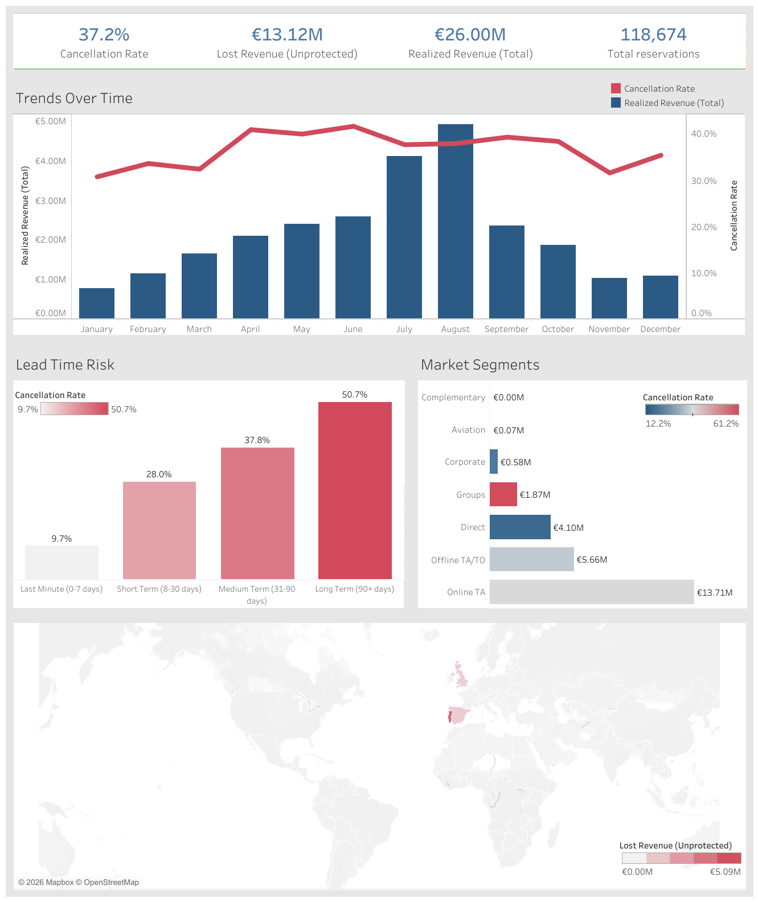

*Read this in other languages: [Español](README_es.md)*

# Hotel Revenue & Cancellation Analysis

## Interactive Dashboard

Explore the interactive analysis in Tableau Public:
[View Dashboard in Tableau Public](https://public.tableau.com/app/profile/armando.guarnera/viz/hotel_bookingsdashboard/Dashboard)

## Dashboard Preview



## Project Overview

This project is an end-to-end analysis of hotel booking trends, focused on revenue management and cancellation behavior.

Using a real booking dataset from two Portuguese hotels (a city hotel in Lisbon and a resort in the Algarve, with arrivals from July 2015 to August 2017), the goal is to uncover cancellation patterns, evaluate distribution channels and quantify the revenue lost to cancellations.

The dashboard is a decision tool for revenue managers and hotel executives who set pricing, overbooking and deposit policies.

---

## Business Problem

Cancellations are one of the biggest operational and financial problems in the hotel industry: they leave rooms empty and revenue unrealized.

Understanding what drives them lets a hotel move from reacting to anticipating, with:

- Dynamic pricing
- Targeted marketing actions
- Stricter deposit policies for high-risk segments
- Better-calibrated overbooking

---

## Data Decisions

The script `data_processing_pipeline.py` automates the ETL process. Three decisions shape every number in the dashboard:

- **The unit of analysis is the room booking.** The dataset has no booking ID, and 26.8% of its rows are exact copies of another row. They concentrate where several rooms are booked together: 75% of the *Groups* rows are repeated, and Groups, Offline TA/TO and Online TA account for 46.5%, 32.3% and 15.2% of the copies. A repeated row is read as another room of the same booking, not as a duplicate record, so for revenue accounting every row counts. Without a booking ID this is an assumption, not something the data can prove.
- **Revenue is estimated as average daily rate x nights.** Stays with zero nights or a negative rate are removed (716 rows), leaving 118,674 room bookings.
- **Lost revenue excludes cancellations protected by a non-refundable deposit.** When a guest cancels a non-refundable booking, the hotel keeps the deposit, so that value is reported separately instead of being counted as lost.

---

## Key Findings

### Financial Impact

Amounts are in euros: both hotels are in Portugal and the dataset reports the average daily rate (ADR) in EUR.

- **118,674** room bookings, with a **37.2% cancellation rate**.
- **€26.00M** in realized revenue.
- **€13.12M** in revenue lost to cancellations without deposit protection.
- A further **€3.60M** corresponds to cancelled non-refundable bookings, where the deposit was kept.

### Lead Time Predicts Cancellation Risk

| Lead time segment | Cancellation rate |
|---|---|
| Last minute (0-7 days) | 9.7% |
| Short term (8-30 days) | 28.0% |
| Medium term (31-90 days) | 37.8% |
| Long term (90+ days) | 50.7% |

Bookings made more than 90 days ahead are cancelled five times as often as last-minute bookings.

### Market Segment Volatility

- **Online TA** is the main revenue driver (**€13.71M** realized) and also the main source of risk: **€10.21M** of lost revenue, 78% of the total.
- **Groups** cancel the most (**61.2%**), but almost half of their bookings carry a non-refundable deposit, so their unprotected loss is limited to **€0.65M**.

### Hotel Type and Seasonality

- The City Hotel cancels far more than the Resort (**41.9%** vs. **28.0%**).
- Revenue peaks in **August** (**€4.92M** realized), and cancellation rates stay high during the peak season, which is when overbooking decisions matter most.

### A Data Caveat

Non-refundable bookings are cancelled 99.4% of the time, and 97.2% of them come from Portugal. That pattern is unusual for real guests and may reflect how some agencies or groups block inventory; it should be checked with the hotels before designing a deposit policy around it.

---

## Tableau Dashboard

### Dashboard Modules

#### KPIs

Cancellation rate, lost revenue (unprotected), realized revenue and total bookings.

#### Trends Over Time

Dual axis chart with realized revenue (bars) and cancellation rate (line) by month, to identify seasonal risk.

#### Lead Time Risk

Cancellation rate by lead time segment.

#### Market Segments

Realized revenue by segment, colored by cancellation rate: the risk-reward trade-off of each channel.

#### Global Impact

Map of lost revenue by guest country of origin.

---

## How to Run This Project

```bash
git clone https://github.com/arguar13/Tableau-Hotel-Bookings.git
cd Tableau-Hotel-Bookings
pip install -r requirements.txt
python data_processing_pipeline.py
```

The script downloads the dataset and creates `end_processed_hotel_bookings.csv` (also included in the repository). Then open `hotel_bookings dashboard.twbx` in Tableau Desktop or Tableau Public: the packaged workbook includes its data extract, so it opens directly.

---

## Data Source

Antonio, N., de Almeida, A., & Nunes, L. (2019). Hotel booking demand datasets. *Data in Brief, 22*, 41-49. https://doi.org/10.1016/j.dib.2018.11.126

---

## Author

**Armando Guarnera**
Data Scientist
Argentina
