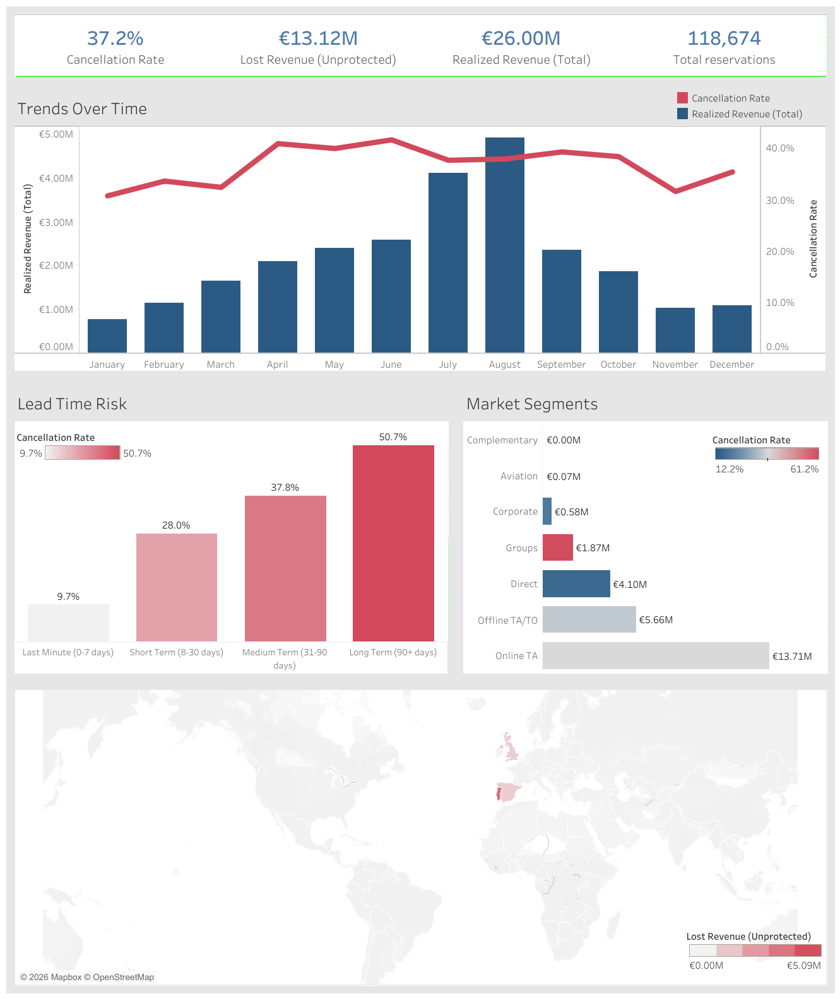

*Leer este documento en otros idiomas: [English](README.md)*

# Análisis de Ingresos y Cancelaciones Hoteleras

## Dashboard Interactivo

Explora el análisis interactivo en Tableau Public:
[Ver Dashboard en Tableau Public](https://public.tableau.com/app/profile/armando.guarnera/viz/hotel_bookingsdashboard/Dashboard)

## Vista Previa del Dashboard



## Descripción General del Proyecto

Este proyecto es un análisis de principio a fin de las tendencias de reservas hoteleras, con foco en la gestión de ingresos y en el comportamiento de cancelación.

Con un dataset real de reservas de dos hoteles portugueses (un hotel urbano en Lisboa y un resort en el Algarve, con llegadas entre julio de 2015 y agosto de 2017), el objetivo es descubrir patrones de cancelación, evaluar los canales de distribución y cuantificar los ingresos perdidos por cancelaciones.

El dashboard es una herramienta de decisión para revenue managers y ejecutivos hoteleros que definen precios, sobreventa y políticas de depósito.

---

## Problema de Negocio

Las cancelaciones son uno de los mayores problemas operativos y financieros de la hotelería: dejan habitaciones vacías e ingresos sin realizar.

Entender qué las impulsa permite pasar de reaccionar a anticiparse, con:

- Precios dinámicos
- Acciones de marketing segmentadas
- Políticas de depósito más estrictas para segmentos de alto riesgo
- Sobreventa mejor calibrada

---

## Decisiones sobre los Datos

El script `data_processing_pipeline.py` automatiza el proceso ETL. Tres decisiones definen todas las cifras del dashboard:

- **La unidad de análisis es la reserva de habitación.** El dataset no tiene ID de reserva, y el 26,8% de sus filas son copias exactas de otra fila. Se concentran donde se reservan varias habitaciones juntas: el 75% de las filas de *Groups* está repetido, y Groups, Offline TA/TO y Online TA suman el 46,5%, el 32,3% y el 15,2% de las copias. Una fila repetida se interpreta como otra habitación de la misma reserva, no como un registro duplicado, así que para contabilizar ingresos cuenta cada fila. Sin un ID de reserva es un supuesto, no algo que los datos puedan probar.
- **El ingreso se estima como tarifa diaria promedio x noches.** Se eliminan las estadías de cero noches o con tarifa negativa (716 filas), y quedan 118.674 reservas de habitación.
- **El ingreso perdido excluye las cancelaciones protegidas por un depósito no reembolsable.** Cuando un huésped cancela una reserva no reembolsable, el hotel conserva el depósito, así que ese valor se informa por separado en lugar de contarse como perdido.

---

## Principales Hallazgos

### Impacto Financiero

Los importes están en euros: los dos hoteles están en Portugal y el dataset informa la tarifa diaria promedio (ADR) en EUR.

- **118.674** reservas de habitación, con una **tasa de cancelación de 37,2%**.
- **26,00 M€** de ingresos realizados.
- **13,12 M€** de ingresos perdidos por cancelaciones sin protección de depósito.
- Otros **3,60 M€** corresponden a reservas no reembolsables canceladas, en las que se conservó el depósito.

### La Anticipación Predice el Riesgo de Cancelación

| Segmento de anticipación | Tasa de cancelación |
|---|---|
| Último minuto (0-7 días) | 9,7% |
| Corto plazo (8-30 días) | 28,0% |
| Mediano plazo (31-90 días) | 37,8% |
| Largo plazo (90+ días) | 50,7% |

Las reservas hechas con más de 90 días de anticipación se cancelan cinco veces más que las de último minuto.

### Volatilidad por Segmento de Mercado

- **Online TA** es el principal generador de ingresos (**13,71 M€** realizados) y también la principal fuente de riesgo: **10,21 M€** de ingresos perdidos, el 78% del total.
- **Groups** es el segmento que más cancela (**61,2%**), pero casi la mitad de sus reservas tiene depósito no reembolsable, por lo que su pérdida sin protección se limita a **0,65 M€**.

### Tipo de Hotel y Estacionalidad

- El hotel urbano cancela mucho más que el resort (**41,9%** frente a **28,0%**).
- Los ingresos alcanzan su pico en **agosto** (**4,92 M€** realizados), y la cancelación se mantiene alta en temporada alta, justo cuando más importan las decisiones de sobreventa.

### Una Advertencia sobre los Datos

Las reservas no reembolsables se cancelan el 99,4% de las veces, y el 97,2% proviene de Portugal. Ese patrón es inusual para huéspedes reales y puede reflejar cómo algunas agencias o grupos bloquean inventario; conviene validarlo con los hoteles antes de diseñar una política de depósitos basada en él.

---

## Dashboard en Tableau

### Módulos del Dashboard

#### KPIs

Tasa de cancelación, ingreso perdido (sin protección), ingreso realizado y total de reservas.

#### Tendencias en el Tiempo

Gráfico de doble eje con ingreso realizado (barras) y tasa de cancelación (línea) por mes, para identificar el riesgo estacional.

#### Riesgo por Anticipación

Tasa de cancelación por segmento de anticipación de la reserva.

#### Segmentos de Mercado

Ingreso realizado por segmento, coloreado por tasa de cancelación: la relación riesgo-beneficio de cada canal.

#### Impacto Global

Mapa del ingreso perdido según el país de origen del huésped.

---

## Cómo Ejecutar Este Proyecto

```bash
git clone https://github.com/arguar13/Tableau-Hotel-Bookings.git
cd Tableau-Hotel-Bookings
pip install -r requirements.txt
python data_processing_pipeline.py
```

El script descarga el dataset y genera `end_processed_hotel_bookings.csv` (también incluido en el repositorio). Luego abre `hotel_bookings dashboard.twbx` en Tableau Desktop o Tableau Public: el workbook empaquetado incluye su extracto de datos, así que abre directamente.

---

## Fuente de Datos

Antonio, N., de Almeida, A., & Nunes, L. (2019). Hotel booking demand datasets. *Data in Brief, 22*, 41-49. https://doi.org/10.1016/j.dib.2018.11.126

---

## Autor

**Armando Guarnera**
Científico de Datos
Argentina
